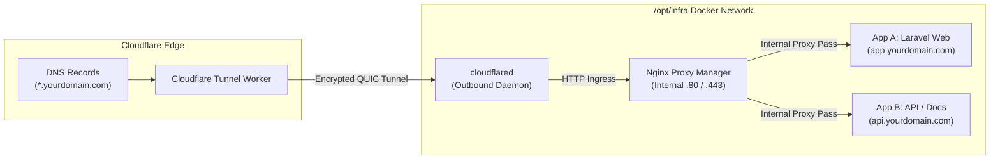

# Cloudflare Tunnel & Edge Routing Architecture

## 1. Overview

In unprivileged container environments (like Proxmox LXC) or university networks, obtaining dedicated public IP addresses, opening ports through institutional firewalls, or negotiating reverse proxy subpath additions is often impossible or strictly regulated.

**Cloudflare Tunnel** (`cloudflared`) solves this problem by establishing secure, outbound-only, bi-directional connections over encrypted QUIC/HTTP2 to the nearest Cloudflare Edge data centers.

---

## 2. Ingress Architecture & The "One Tunnel -> NPM" Paradigm

Rather than creating a separate Cloudflare Public Hostname entry for every new container or application you launch, this architecture routes **wildcard or root domains** to a single internal entry point: **Nginx Proxy Manager (NPM)**.



### Why this paradigm is superior:
1. **Zero Configuration in Cloudflare Dashboard for New Apps**: Add `*.yourdomain.com` once in the Cloudflare Zero Trust Tunnel dashboard. From that moment forward, any new service or subdomain is configured purely inside your local NPM UI (`http://localhost:81`).
2. **Path Rewriting & Custom Headers**: NPM handles granular Nginx directives, custom header forwarding (`X-Forwarded-For`, `X-Forwarded-Proto`), and subpath routing locally.
3. **Internal SSL Flexibility**: Cloudflare Edge handles public SSL termination; NPM can optionally manage internal Let's Encrypt certificates or operate seamlessly in HTTP mode behind the secure tunnel.

---

## 3. Configuration Breakdown

### 3.1 Docker Compose Configuration (`services/cloudflared/compose.yaml`)
The `cloudflared` container runs purely on the internal Docker network `infra_network`:

```yaml
name: infra-cloudflared

services:
  cloudflared:
    image: cloudflare/cloudflared:latest
    container_name: infra-cloudflared
    restart: unless-stopped
    command: tunnel --no-autoupdate run
    environment:
      - TUNNEL_TOKEN=${CLOUDFLARE_TUNNEL_TOKEN}
    networks:
      - infra_network

networks:
  infra_network:
    name: infra_network
    external: true
```

### 3.2 Ingress Rules (Cloudflare Dashboard Modern Routes UI)
In the modern Cloudflare Dashboard (`Networks` -> `Tunnels` -> your tunnel -> `Routes` tab):

| Order | Destination (Hostname) | Type | Service URL | Purpose |
| :---: | :--- | :--- | :--- | :--- |
| **1** | `npm.yourdomain.com` | Published application | `http://npm:81` | Direct access to NPM Admin Dashboard (port 81) |
| **2** | `yourdomain.com` | Published application | `http://npm:80` | Apex/Root domain forwarded to NPM (port 80) |
| **3** | `*.yourdomain.com` | Published application | `http://npm:80` | Wildcard catching all other subdomains into NPM (port 80) |

> [!IMPORTANT]
> **Order of Routes Matters!** Cloudflare matches routes from **top to bottom** and stops at the first match:
> - Specific routes like `npm.yourdomain.com` **must be listed before** `*.yourdomain.com`.
> - If `*.yourdomain.com` is placed above `npm.yourdomain.com`, visiting `npm.yourdomain.com` will be sent to port 80 (NPM Default Page) instead of the admin panel on port 81!
> - The Service URL must use **`http://`** (not `https://`), and target container names directly (`http://npm:80` or `http://npm:81`), **not** `localhost` (which inside Docker refers to the `cloudflared` container itself).

---

## 4. Step-by-Step Setup Guide

### Step 1: Create a Cloudflare Tunnel
1. Log in to [Cloudflare Zero Trust](https://one.dash.cloudflare.com/).
2. Navigate to **Networks** -> **Tunnels** -> **Create a Tunnel**.
3. Select **Cloudflare (Recommended)**.
4. Name your tunnel (e.g., `campus-infra-tunnel`).
5. In the install connector screen, select **Docker**.
6. Copy the token provided in the snippet (the string following `--token`).

### Step 2: Configure Environment Variable
In `/opt/infra/services/cloudflared/`:
```bash
cp .env.example .env
nano .env
```
Add:
```bash
CLOUDFLARE_TUNNEL_TOKEN=eyJhIjoiYmNkZWY...your_copied_token
```

### Step 3: Configure Ingress Routes in Cloudflare Dashboard
In the **Routes** tab of the Tunnel configuration, click **+ Add route** -> **Published application**:
1. **Route 1 (NPM Admin Panel)**:
   - Subdomain: `npm`
   - Domain: `yourdomain.com`
   - Service URL: `http://npm:81`
2. **Route 2 (Root Domain)**:
   - Subdomain: *(leave empty)*
   - Domain: `yourdomain.com`
   - Service URL: `http://npm:80`
3. **Route 3 (Wildcard Catch-All)**:
   - Subdomain: `*`
   - Domain: `yourdomain.com`
   - Service URL: `http://npm:80`

*(Ensure Route 1 is ordered above Route 3 so Cloudflare matches the specific `npm` admin subdomain first).*

### Step 4: Start the Service
```bash
cd /opt/infra/services/cloudflared
docker compose up -d
docker compose logs -f
```
You should see:
```text
INF Connection registered connIndex=0 ...
INF Registered at tunnel core ...
```

---

## 5. Troubleshooting & FAQ

#### 1. Error: `Cannot resolve host npm`
- **Cause**: The `cloudflared` container and the `npm` container are not on the same Docker network.
- **Fix**: Verify both containers belong to `infra_network` or check with `docker network inspect infra_network`.

#### 2. Error: `502 Bad Gateway` returned by Cloudflare
- **Cause**: Cloudflare reached `cloudflared`, but `cloudflared` could not connect to `npm:80`.
- **Fix**: Check if NPM is running: `docker compose -f /opt/infra/services/npm/compose.yaml ps`. Check NPM logs: `docker compose -f /opt/infra/services/npm/compose.yaml logs`.

#### 3. Upload Limit Exceeded (413 Payload Too Large)
- **Constraint**: Cloudflare's free tier has a 100 MB upload limit for proxied traffic.
- **Fix**: For file transfers larger than 100 MB, route requests via Tailscale SOCKS5 or chunk uploads via frontend JavaScript.
