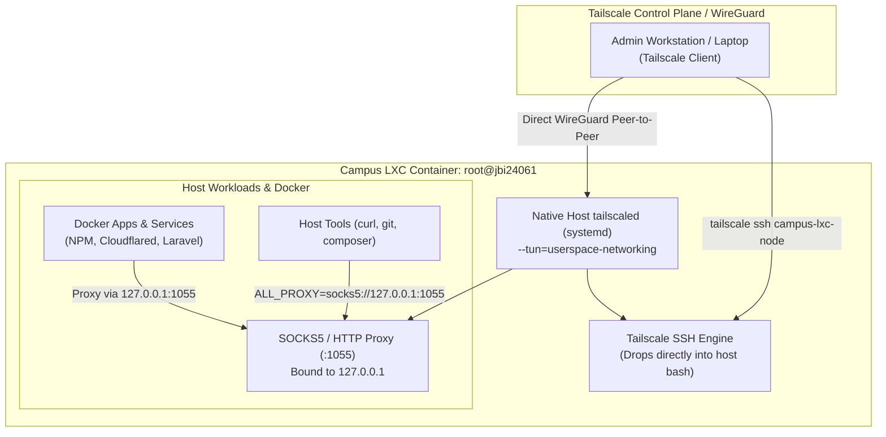

# Tailscale in Userspace Mode (Host-Native Implementation)

## 1. Context & The "No TUN" Problem in Unprivileged LXC

In unprivileged Linux Containers (such as standard Proxmox LXC containers without host-level kernel device passthrough), the virtual network device `/dev/net/tun` does **not** exist or is permission-restricted.

### What happens when running standard Tailscale or WireGuard:
```text
failed to create TUN device: open /dev/net/tun: no such file or directory
```
Because unprivileged containers cannot manipulate host kernel routing tables or mount arbitrary character devices without host admin intervention, standard Layer-3 VPN tunneling fails.

---

## 2. Solution: Native Host Userspace Networking (`netstack`)

Tailscale provides an internal networking stack implemented entirely in Go (`netstack`). In this mode:
1. Tailscale **does not** create a virtual network interface on the kernel (`tailscale0`).
2. Tailscale listens as an internal **SOCKS5 and HTTP proxy** directly on `127.0.0.1:1055`.
3. Tailscale runs an internal SSH server (`tailscale ssh`) directly on the host OS.

### Why Containerized Tailscale Was Deprecated for Host Administration:
Running Tailscale inside a Docker container traps the SSH daemon inside that container's isolated filesystem (e.g. Alpine Linux). Connecting via Tailscale SSH gave a shell inside `4be38c45cb23:~#` rather than the actual host system `root@jbi24061 ~#`, preventing system administration (`systemctl`, `docker`, `apt`).

**The Native Host implementation solves this completely by running Tailscale directly on the Debian/TurnKey host:**



---

## 3. Host-Level Deployment Guide

### Automated Setup
On your TurnKey Debian host (`root@jbi24061`):
```bash
cd /opt/infra
chmod +x scripts/setup-host-tailscale.sh
./scripts/setup-host-tailscale.sh
```

### Manual Configuration Breakdown
If you prefer configuring it manually:

1. **Install Tailscale Package**:
   ```bash
   curl -fsSL https://tailscale.com/install.sh | sh
   ```

2. **Configure Systemd Override for Unprivileged LXC**:
   In unprivileged LXC containers without `/dev/net/tun`, Debian's stock `tailscaled.service` fails during startup because `ExecStartPre=/usr/sbin/tailscaled --cleanup` attempts to enumerate a non-existent `tailscale0` kernel interface.
   
   To bypass this, create a systemd drop-in override:
   ```bash
   mkdir -p /etc/systemd/system/tailscaled.service.d

   cat << 'EOF' > /etc/systemd/system/tailscaled.service.d/override.conf
   [Service]
   ExecStartPre=
   ExecStart=
   ExecStart=/usr/sbin/tailscaled --state=/var/lib/tailscale/tailscaled.state --socket=/run/tailscale/tailscaled.sock --port=41641 --tun=userspace-networking --socks5-server=127.0.0.1:1055 --outbound-http-proxy-listen=127.0.0.1:1055
   EOF
   ```

3. **Reload and Enable Service**:
   ```bash
   systemctl daemon-reload
   systemctl enable --now tailscaled
   ```

4. **Authenticate Node with SSH Enabled**:
   ```bash
   tailscale up --ssh --hostname=campus-lxc-node
   ```
   *(Or headlessly: `tailscale up --authkey=tskey-auth-xxxx --ssh --hostname=campus-lxc-node`)*.

---

## 4. Tailscale ACL Policy Configuration

Tailscale SSH is secure by default. By default, connections to `root` or unlisted users will be refused with:
```text
tailscale: tailnet policy does not permit you to SSH as user "root"
```

### Fix in Tailscale Admin Console:
1. Navigate to [Tailscale Admin Console: Access Controls](https://login.tailscale.com/admin/acls).
2. Ensure the `"ssh"` policy block explicitly allows `root` (and any local client usernames):

```json
"ssh": [
  {
    "action": "accept",
    "src": ["autogroup:member"],
    "dst": ["autogroup:self", "tag:server"],
    "users": ["root", "autogroup:nonroot"]
  }
]
```
3. Click **Save**.

---

## 5. How to Use the Connection

### Scenario A: Direct Remote SSH Access to LXC Host
From your development laptop:
```bash
ssh root@campus-lxc-node
```
or:
```bash
tailscale ssh root@campus-lxc-node
```
You will land directly in your TurnKey Debian 12 environment:
```text
Welcome to Jbi24061, TurnKey GNU/Linux 18.0 (Debian 12/Bookworm)
root@jbi24061 ~#
```

### Scenario B: Route Local Application Traffic through Tailnet
To route outgoing server traffic through your private Tailnet (e.g. to reach an internal staging database or API):

```bash
export ALL_PROXY=socks5://127.0.0.1:1055
curl https://private-service.tailnet-name.ts.net
```

In PHP / Laravel:
```php
use Illuminate\Support\Facades\Http;

$response = Http::withOptions([
    'proxy' => 'socks5://127.0.0.1:1055',
])->get('https://internal-api.tailnet-name.ts.net/data');
```

---

## 6. Troubleshooting & Gotchas

#### 1. `router: enumerating tailscale0 addresses for cleanup failed`
- **Cause**: In Debian 12 / TurnKey unprivileged LXC, the stock `tailscaled.service` runs `ExecStartPre=/usr/sbin/tailscaled --cleanup`, which looks for a kernel interface `tailscale0` and crashes when `/dev/net/tun` is missing.
- **Fix**: Use the systemd drop-in override `/etc/systemd/system/tailscaled.service.d/override.conf` with an empty `ExecStartPre=` line and `--tun=userspace-networking` in `ExecStart`.

#### 2. SSH lands in Alpine Linux (`Welcome to Alpine!`)
- **Cause**: Tailscale was running in a Docker container with `--ssh`. Containerized Tailscale traps SSH inside its own isolated container filesystem.
- **Fix**: Stop and remove the Docker Tailscale container (`docker rm -f infra-tailscale`) and run Tailscale directly on the host using `scripts/setup-host-tailscale.sh`.

#### 2. `tailscale: tailnet policy does not permit you to SSH as user "root"`
- **Cause**: The Tailscale ACL policy does not have `root` listed in the `"users"` array of the `"ssh"` block.
- **Fix**: Add `"root"` to the `"ssh"` rule in the Tailscale Admin Console.

#### 3. Standard `ping` fails to Tailscale IP
- **Expected Behavior**: In userspace networking mode, standard OS `ping` from the container host **will not work** because there is no Layer-3 kernel interface (`tailscale0`). All interaction is handled via Tailscale SSH or via the SOCKS5/HTTP proxies at `127.0.0.1:1055`.
